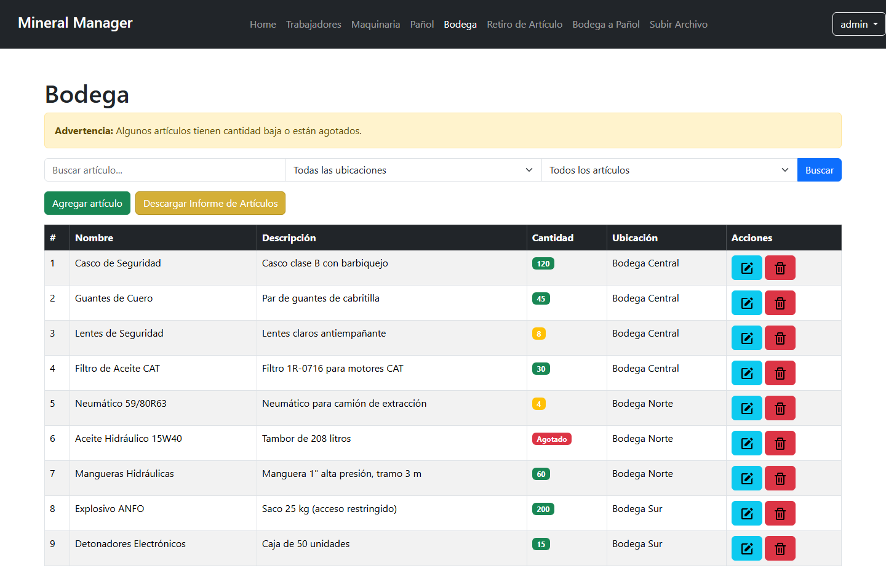
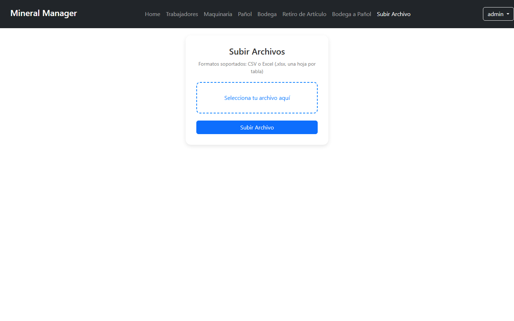

<div align="center">

# ⛏️ Mineral Manager

**Sistema web para la gestión operativa de una faena minera:** trabajadores, certificaciones, maquinaria, bodega y pañol en un solo lugar.


</div>

---

## 📋 Contenido

- [Funcionalidades](#-funcionalidades)
- [Capturas](#-capturas)
- [Instalación](#-instalación)
- [Probar con datos de ejemplo (Excel)](#-probar-con-datos-de-ejemplo-excel)
- [Formato de los archivos de carga](#-formato-de-los-archivos-de-carga)
- [Estructura del proyecto](#-estructura-del-proyecto)

## ✨ Funcionalidades

| Módulo | Qué permite hacer |
|---|---|
| **Panel principal** | Resumen de trabajadores activos, stock bajo, maquinaria en mantenimiento o inactiva y certificaciones por vencer. |
| **Trabajadores** | Alta, edición y baja de trabajadores; filtros por área, turno y estado de certificaciones; informe en PDF. |
| **Certificaciones** | Capacitaciones renovables (con fecha de vencimiento) y no renovables; alertas a 30 y 90 días y vencidas. |
| **Maquinaria** | Estado de cada equipo, historial de mantenimientos y trabajos, con cálculo automático de horas. |
| **Bodega y Pañol** | Inventario con alertas de stock bajo (≤ 10) y agotado, filtros por ubicación e informes en PDF. |
| **Bodega → Pañol** | Traspaso de artículos entre ubicaciones con registro del movimiento. |
| **Retiro de artículos** | Préstamo de herramientas del pañol a trabajadores y registro de devoluciones. |
| **Carga masiva** | Importación desde **CSV** o desde un **Excel (.xlsx) con varias hojas** en una sola subida. |
| **Usuarios** | Inicio de sesión y recuperación de contraseña por correo. |

## 📸 Capturas

<table>
  <tr>
    <td align="center"><br><sub><b>Inicio de sesión</b></sub></td>
    <td align="center"><br><sub><b>Gestión de trabajadores</b></sub></td>
  </tr>
  <tr>
    <td align="center"><br><sub><b>Maquinaria</b></sub></td>
    <td align="center"><br><sub><b>Trabajos por máquina</b></sub></td>
  </tr>
  <tr>
    <td align="center"><br><sub><b>Pañol</b></sub></td>
    <td align="center"><br><sub><b>Bodega</b></sub></td>
  </tr>
  <tr>
    <td align="center"><br><sub><b>Retiro de artículos</b></sub></td>
    <td align="center"><br><sub><b>Carga de archivos</b></sub></td>
  </tr>
</table>

## 🚀 Instalación

> Requiere **Python 3.10 a 3.13**. Django 4.2 todavía no funciona con Python 3.14.

```bash
# 1. Clonar el repositorio
git clone https://github.com/y-jeff/Mineral_Manager.git
cd Mineral_Manager

# 2. Crear y activar un entorno virtual
python -m venv venv
venv\Scripts\activate          # Windows
# source venv/bin/activate     # macOS / Linux

# 3. Instalar dependencias
pip install -r requirements.txt

# 4. Crear la base de datos y un usuario administrador
python manage.py migrate
python manage.py createsuperuser

# 5. Levantar el servidor
python manage.py runserver
```

Abre <http://127.0.0.1:8000> e inicia sesión con el usuario que creaste.

### Variables de entorno (opcionales)

Para desarrollo local no hace falta configurar nada. Para producción o para que funcione la recuperación de contraseña, define estas variables (hay un ejemplo en [`.env.example`](.env.example)):

| Variable | Uso |
|---|---|
| `DJANGO_SECRET_KEY` | Clave secreta de Django. **Obligatoria en producción.** |
| `DJANGO_DEBUG` | `True` o `False`. |
| `EMAIL_HOST_USER` | Correo Gmail desde el que se envían los enlaces de recuperación. |
| `EMAIL_HOST_PASSWORD` | [Contraseña de aplicación](https://myaccount.google.com/apppasswords) de ese correo. |
| `DJANGO_DB_PATH` | Ruta a otro archivo SQLite (por defecto `db.sqlite3`). |

```powershell
# Windows (PowerShell)
$env:EMAIL_HOST_USER = "tu-correo@gmail.com"
$env:EMAIL_HOST_PASSWORD = "xxxx xxxx xxxx xxxx"
```

## 🧪 Probar con datos de ejemplo (Excel)

El repositorio incluye un Excel listo para cargar y probar **todas** las secciones:

📄 [`datos_prueba/MineralManager_Datos_Prueba.xlsx`](datos_prueba/MineralManager_Datos_Prueba.xlsx)

1. Inicia sesión y entra a **Subir Archivo**.
2. Selecciona el Excel y presiona **Subir**.
3. Recorre el sistema: el panel principal ya muestra alertas, stock bajo y certificaciones por vencer.

| Hoja | Registros | Qué permite probar |
|---|---:|---|
| Trabajadores | 12 | Áreas, cargos, turnos A/B, jornadas y horas trabajadas vs. esperadas |
| Maquinarias | 8 | Estados *Activo*, *En Mantenimiento* e *Inactivo* |
| Inventario Bodega | 9 | Stock normal, bajo y agotado |
| Inventario Pañol | 8 | Stock normal, bajo y agotado |
| Capacitaciones | 14 | Certificaciones vencidas, por vencer (< 30 y < 90 días), vigentes y no renovables |
| Mantenimientos | 5 | Historial por máquina |
| Trabajos Maquinaria | 6 | Horas calculadas automáticamente desde inicio y fin |

Las fechas se calculan respecto al día en que se generó el archivo. Para regenerarlo con fechas actuales:

```bash
python datos_prueba/generar_excel.py
```

> Si una hoja tiene un error, **no se guarda nada** del archivo y se muestra el motivo. Los mantenimientos y trabajos se agregan cada vez que se sube el archivo, así que conviene cargarlo una sola vez por base de datos.

## 📑 Formato de los archivos de carga

Puedes subir un **CSV por tabla** o un **Excel con una hoja por tabla** (el orden de las hojas importa: primero trabajadores y maquinarias). El sistema reconoce cada tabla por los nombres de sus columnas:

| Tabla | Columnas |
|---|---|
| Trabajadores | `RUT`, `Nombre`, `Area`, `Cargo`, `Jornada`, `Turno` (A/B), `Horario`, `Horas`, `Horas Esperadas` |
| Maquinarias | `Código`, `Nombre Maquinaria`, `Fecha Adquisición`, `Estado`, `Area` |
| Inventario Bodega | `Bodega`, `Nombre Articulo`, `Descripción`, `Cantidad` |
| Inventario Pañol | `Pañol`, `Nombre Articulo`, `Descripción`, `Cantidad` |
| Capacitaciones | `RUT`, `Capacitacion`, `Fecha Inicio`, `Fecha Fin` (vacía = no renovable) |
| Mantenimientos | `Código`, `Fecha Mantenimiento`, `Descripción`, `Realizado Por` (nombre del trabajador) |
| Trabajos Maquinaria | `Código`, `RUT`, `Fecha Inicio`, `Fecha Fin` (`AAAA-MM-DD HH:MM`), `Descripción` |

Fechas en formato `AAAA-MM-DD`.

## 🗂️ Estructura del proyecto

```
Mineral_Manager/
├── MineralApp/          # Aplicación principal: modelos, vistas, formularios
├── MineralManager/      # Configuración de Django (settings, urls)
├── templates/           # Plantillas HTML
├── static/              # CSS y JavaScript
├── datos_prueba/        # Excel de ejemplo y script que lo genera
├── docs/img/            # Capturas usadas en este README
├── manage.py
└── requirements.txt
```

## 🛠️ Tecnologías

- **Backend:** Django 4.2 (Python)
- **Frontend:** HTML, Bootstrap 5, JavaScript
- **Base de datos:** SQLite
- **Informes:** ReportLab (PDF) · **Carga de datos:** openpyxl (Excel) y CSV
