<div align="center">


# Mineral Manager

**Sistema web para la gestión operativa de una faena minera:**
trabajadores y certificaciones, maquinaria, bodega y pañol en un solo lugar.

[](https://github.com/y-jeff/Mineral_Manager/actions/workflows/tests.yml)


### [🌐 Ver demo en vivo](https://jeff017.pythonanywhere.com)

Usuario `demo` · Contraseña `demo1234`

[Probar](#-probar) · [Funcionalidades](#-funcionalidades) · [Capturas](#-capturas) · [Aspectos técnicos](#-aspectos-técnicos)

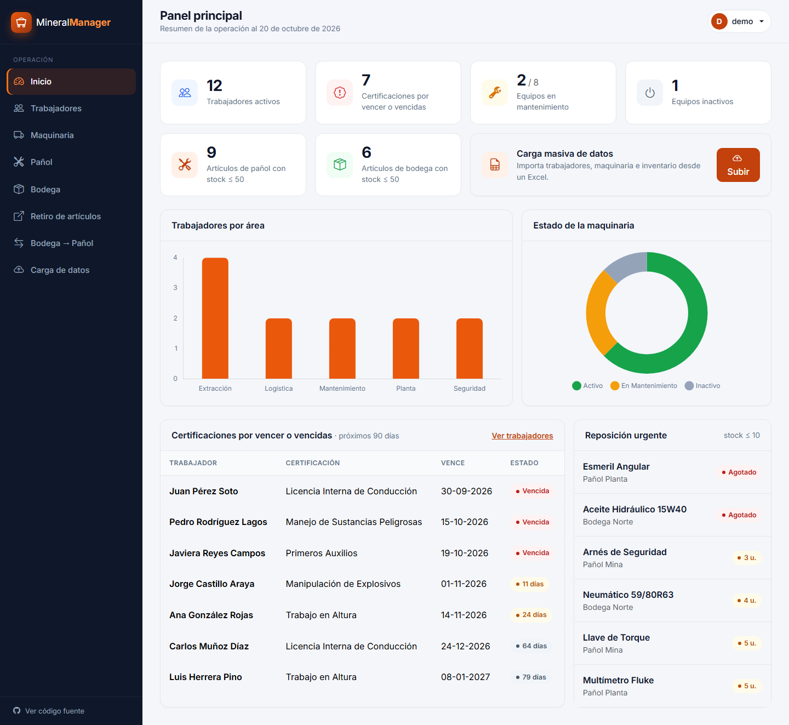

</div>

---

## 🚀 Probar

### En línea (sin instalar nada)

Entra a **<https://jeff017.pythonanywhere.com>** con la cuenta de demostración:

| Usuario | Contraseña |
|---|---|
| `demo` | `demo1234` |

En la pantalla de inicio de sesión también hay un botón **"Usar"** que completa los datos.

> Es una demo pública: lo que agregues, edites o borres lo verán también otros visitantes. Puedes probar todo con libertad; los datos de ejemplo se pueden restaurar en cualquier momento.

### En tu computador (1 minuto)

Solo necesitas **Python 3.10 o superior** ([descargar](https://www.python.org/downloads/)).

```bash
git clone https://github.com/y-jeff/Mineral_Manager.git
cd Mineral_Manager
```

| Sistema | Comando |
|---|---|
| **Windows** | Doble clic en `iniciar_demo.bat` |
| **macOS / Linux** | `./iniciar_demo.sh` |

El script crea el entorno virtual, instala las dependencias, prepara la base de datos con una faena de ejemplo y abre <http://127.0.0.1:8000>.

> **Cuenta de demostración:** usuario `demo` · contraseña `demo1234`
> (también aparece en la pantalla de inicio de sesión, con un botón para completarla).

<details>
<summary><b>Instalación manual</b> (paso a paso)</summary>

```bash
python -m venv venv
venv\Scripts\activate            # Windows
# source venv/bin/activate       # macOS / Linux

pip install -r requirements.txt
python manage.py migrate
python manage.py cargar_demo     # crea la cuenta demo y los datos de ejemplo
python manage.py runserver
```

`cargar_demo --reset` borra los datos y vuelve a cargar la demo con fechas actualizadas.
</details>

## ✨ Funcionalidades

| Módulo | Qué permite hacer |
|---|---|
| **Panel principal** | Indicadores de la operación, gráficos de dotación por área y estado de la maquinaria, certificaciones por vencer y artículos para reponer. |
| **Trabajadores** | Alta, edición y baja; filtros por área, turno y estado de certificaciones; informe en PDF. |
| **Certificaciones** | Renovables (con vencimiento) y no renovables; alertas a 30 y 90 días y vencidas. |
| **Maquinaria** | Estado de cada equipo, registro de mantenimientos y trabajos con cálculo automático de horas. |
| **Bodega y pañol** | Inventario con alertas de stock bajo y agotado, filtros e informes en PDF. |
| **Bodega → Pañol** | Traspasos de stock con historial de movimientos. |
| **Retiro de artículos** | Préstamo de herramientas a trabajadores y registro de devoluciones. |
| **Carga masiva** | Importación desde **Excel** (una hoja por tabla, todo o nada) o **CSV**. |
| **Cuentas** | Inicio de sesión y recuperación de contraseña por correo. |

## 📸 Capturas

<table>
  <tr>
    <td align="center" width="50%">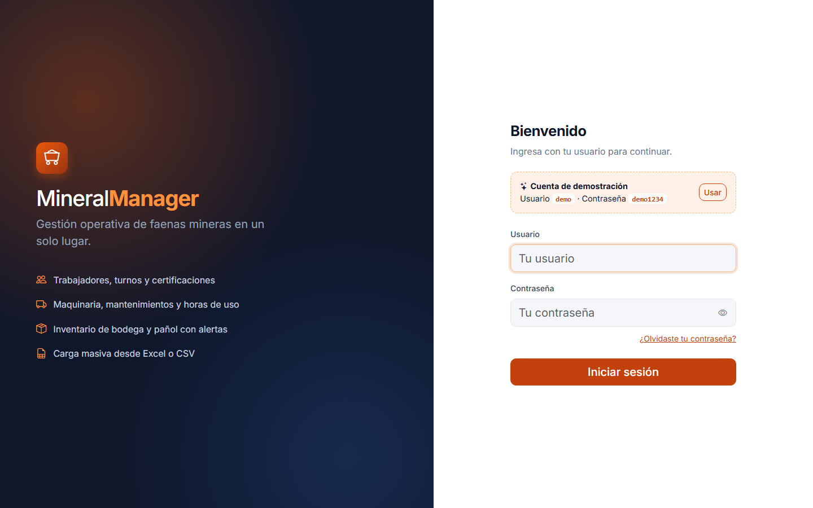<br><sub><b>Inicio de sesión con cuenta demo</b></sub></td>
    <td align="center" width="50%">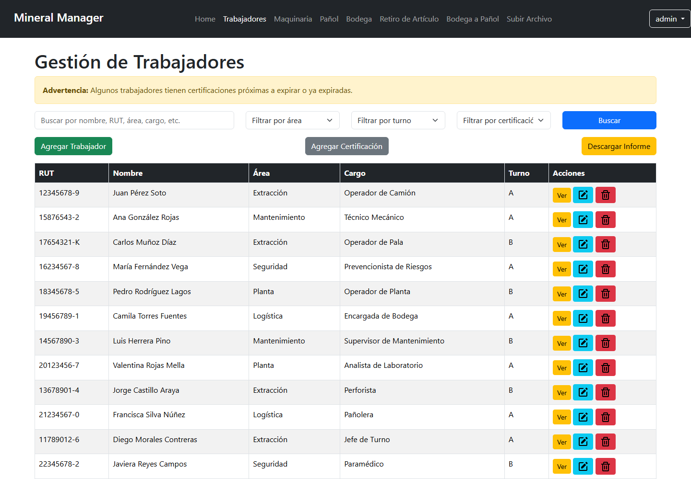<br><sub><b>Trabajadores y estado de certificaciones</b></sub></td>
  </tr>
  <tr>
    <td align="center">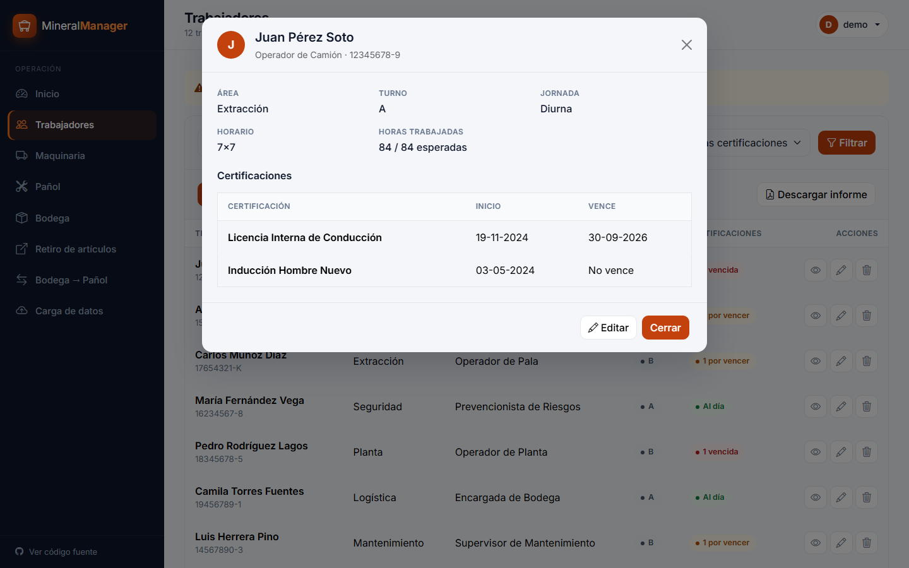<br><sub><b>Ficha del trabajador</b></sub></td>
    <td align="center">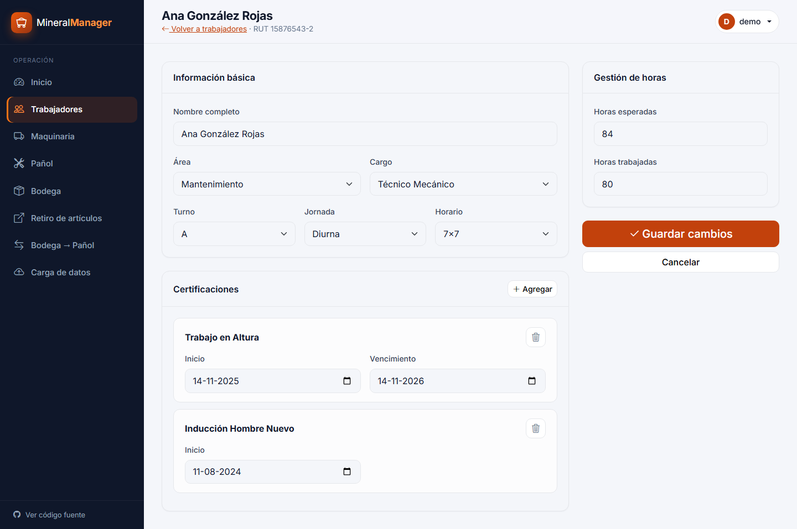<br><sub><b>Edición de datos y certificaciones</b></sub></td>
  </tr>
  <tr>
    <td align="center">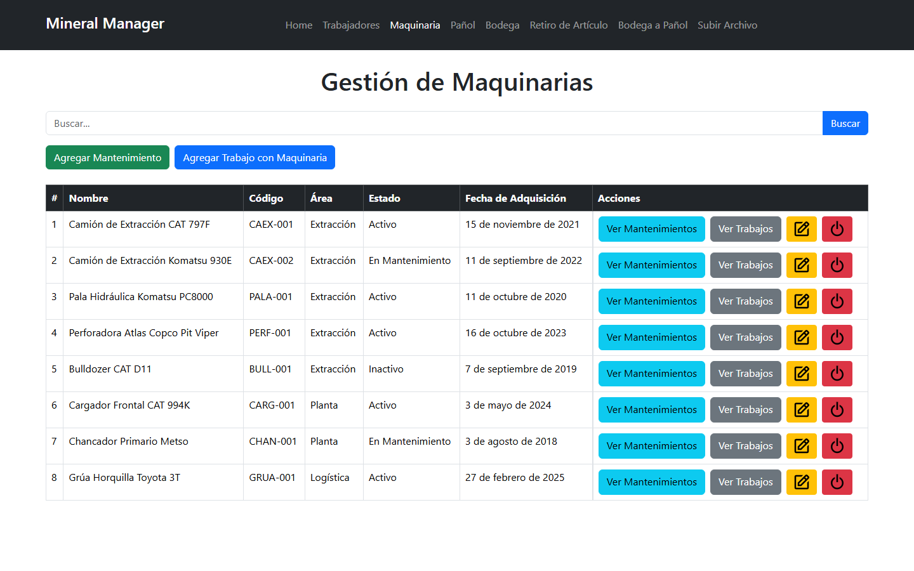<br><sub><b>Maquinaria</b></sub></td>
    <td align="center">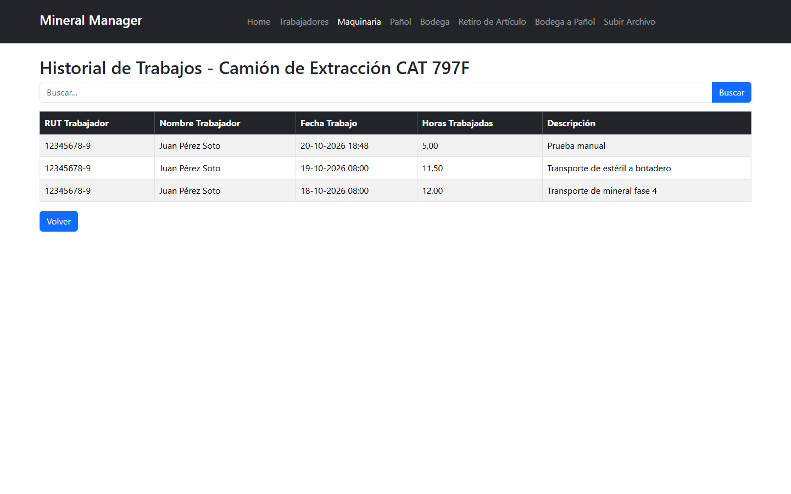<br><sub><b>Historial de trabajos por equipo</b></sub></td>
  </tr>
  <tr>
    <td align="center">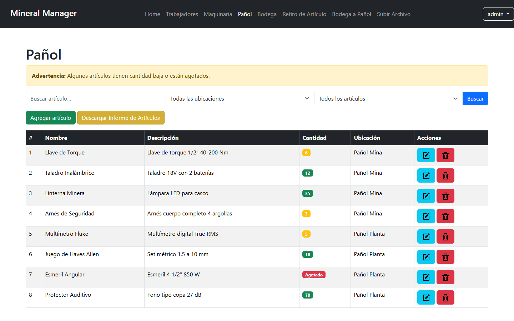<br><sub><b>Inventario del pañol</b></sub></td>
    <td align="center">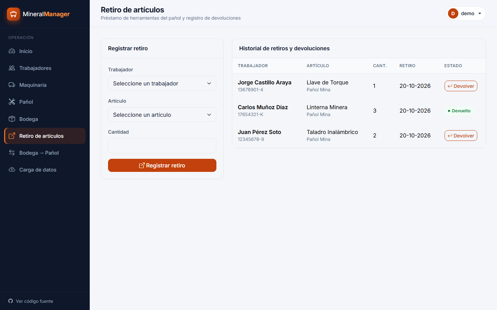<br><sub><b>Retiros y devoluciones</b></sub></td>
  </tr>
  <tr>
    <td align="center">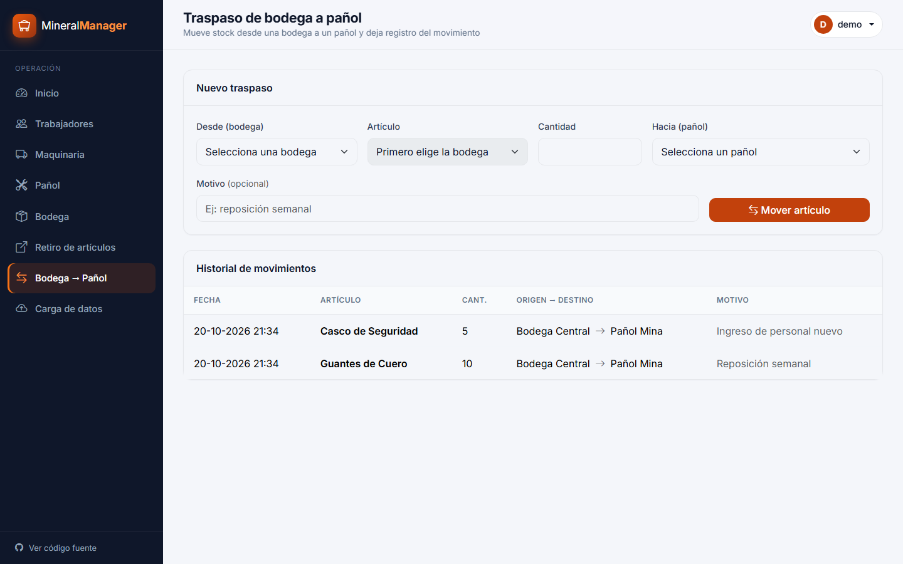<br><sub><b>Traspasos de bodega a pañol</b></sub></td>
    <td align="center">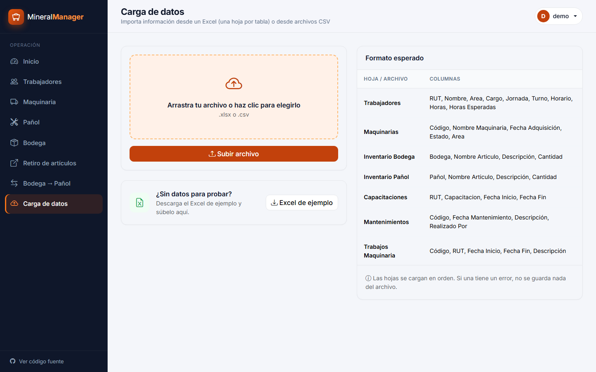<br><sub><b>Carga masiva desde Excel</b></sub></td>
  </tr>
</table>

<p align="center">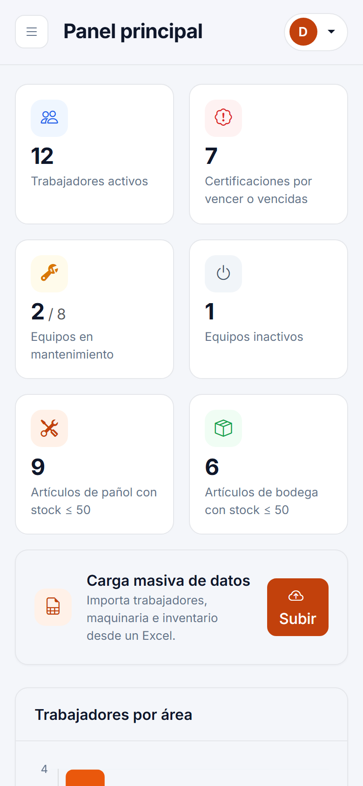<br><sub><b>Diseño adaptable a celulares</b></sub></p>

## 🧠 Aspectos técnicos

- **Arquitectura Django clásica (MVT):** modelos relacionales para la faena, vistas por módulo y plantillas que heredan de un layout común (`base.html`). El menú se genera con un *context processor*.
- **Carga masiva transaccional:** cada hoja del Excel se reconoce por sus columnas y se procesa dentro de `transaction.atomic()`; si una fila falla, no se guarda nada.
- **Integridad del inventario:** los traspasos y retiros actualizan el stock con expresiones `F()` en la base de datos y quedan registrados en su historial.
- **Seguridad:** todas las vistas requieren sesión, las acciones por `fetch` envían token CSRF y las credenciales se leen desde variables de entorno.
- **Pruebas automáticas:** 20 pruebas cubren acceso, carga de datos, trabajadores, inventario y maquinaria. Se ejecutan en GitHub Actions con Python 3.10, 3.12 y 3.14.
- **Listo para producción:** configuración por variables de entorno, cookies seguras, páginas de error propias y guía de despliegue.
- **Datos de demostración reproducibles:** el comando `cargar_demo` arma la faena de ejemplo con fechas relativas al día actual, así siempre hay alertas que mostrar.
- **Informes PDF** con ReportLab y **gráficos** con Chart.js.

```bash
python manage.py test        # ejecuta las pruebas
```

## 📑 Formato de carga de datos

Puedes subir un **Excel con una hoja por tabla** o un **CSV por tabla**. El sistema reconoce cada tabla por sus columnas; el Excel de ejemplo está en [`static/ejemplos/`](static/ejemplos/MineralManager_Datos_Prueba.xlsx) y también se descarga desde la app.

| Tabla | Columnas |
|---|---|
| Trabajadores | `RUT`, `Nombre`, `Area`, `Cargo`, `Jornada`, `Turno` (A/B), `Horario`, `Horas`, `Horas Esperadas` |
| Maquinarias | `Código`, `Nombre Maquinaria`, `Fecha Adquisición`, `Estado`, `Area` |
| Inventario Bodega | `Bodega`, `Nombre Articulo`, `Descripción`, `Cantidad` |
| Inventario Pañol | `Pañol`, `Nombre Articulo`, `Descripción`, `Cantidad` |
| Capacitaciones | `RUT`, `Capacitacion`, `Fecha Inicio`, `Fecha Fin` (vacía = no renovable) |
| Mantenimientos | `Código`, `Fecha Mantenimiento`, `Descripción`, `Realizado Por` |
| Trabajos Maquinaria | `Código`, `RUT`, `Fecha Inicio`, `Fecha Fin` (`AAAA-MM-DD HH:MM`), `Descripción` |

## ⚙️ Configuración y publicación

Para probar en local no hace falta configurar nada. En producción la app lee estas variables desde el entorno o desde un archivo `.env` (ejemplo en [`.env.example`](.env.example)):

| Variable | Uso |
|---|---|
| `DJANGO_DEBUG` | `False` en producción. |
| `DJANGO_SECRET_KEY` | Clave secreta de Django. Con `DJANGO_DEBUG=False` la app no arranca sin ella. |
| `DJANGO_ALLOWED_HOSTS` | Dominios permitidos, separados por coma. |
| `DJANGO_CSRF_TRUSTED_ORIGINS` | Orígenes HTTPS de confianza, por ejemplo `https://midominio.com`. |
| `EMAIL_HOST_USER` / `EMAIL_HOST_PASSWORD` | Cuenta Gmail y [contraseña de aplicación](https://myaccount.google.com/apppasswords) para recuperar contraseñas. |
| `DJANGO_DB_PATH` | Ruta a otro archivo SQLite (por defecto `db.sqlite3`). |

📘 **[Guía para publicar la demo en PythonAnywhere](DEPLOY.md)** (gratis, siempre encendida y con datos que se reinician a diario).

## 🗂️ Estructura del proyecto

```
Mineral_Manager/
├── MineralApp/
│   ├── models.py               # Modelos de la faena
│   ├── views.py                # Vistas, agrupadas por módulo
│   ├── forms.py
│   ├── demo.py                 # Datos de la faena de demostración
│   ├── context_processors.py   # Menú lateral
│   ├── management/commands/
│   │   └── cargar_demo.py      # python manage.py cargar_demo
│   └── tests.py                # Pruebas automáticas
├── MineralManager/             # Configuración de Django (settings, urls)
├── templates/                  # base.html, auth_base.html, páginas y parciales
├── static/                     # Tema (CSS), JavaScript, ícono y Excel de ejemplo
├── docs/img/                   # Capturas de este README
├── iniciar_demo.bat / .sh      # Instalación y arranque en un paso
├── DEPLOY.md                   # Publicación en PythonAnywhere
└── requirements.txt
```

## 🛠️ Tecnologías

**Backend:** Python · Django 5.2 LTS · SQLite  
**Frontend:** HTML · Bootstrap 5.3 · Bootstrap Icons · Chart.js · JavaScript  
**Datos e informes:** openpyxl (Excel) · ReportLab (PDF)  
**Calidad:** pruebas con el framework de Django · GitHub Actions

Historial de versiones en [CHANGELOG.md](CHANGELOG.md).
